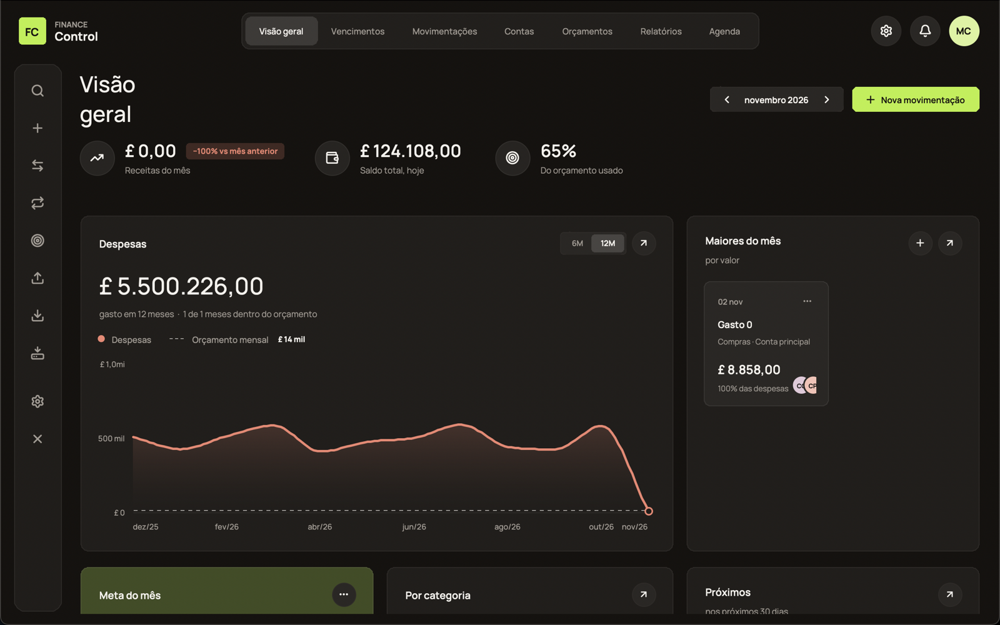
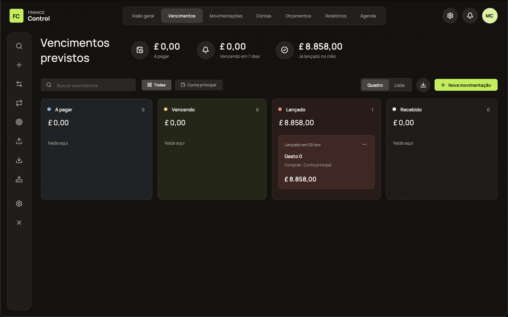
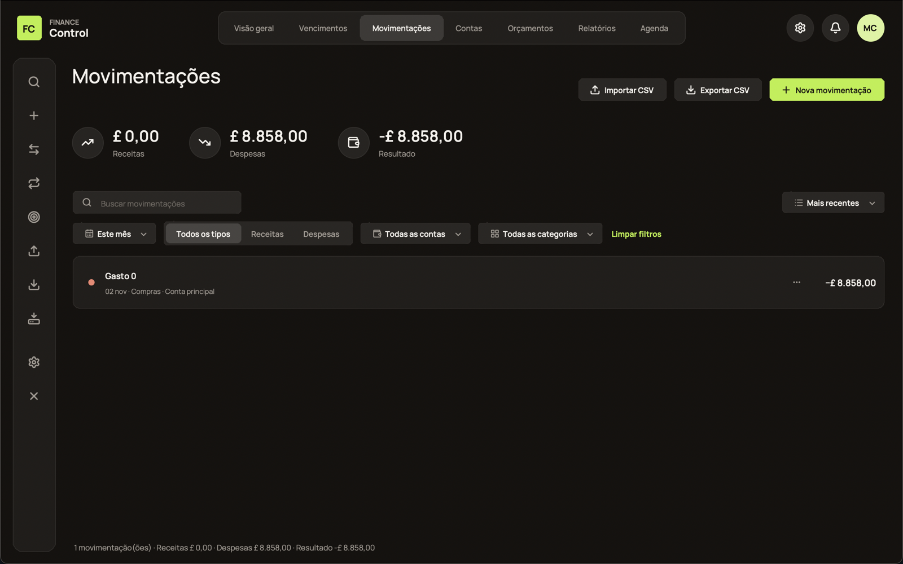
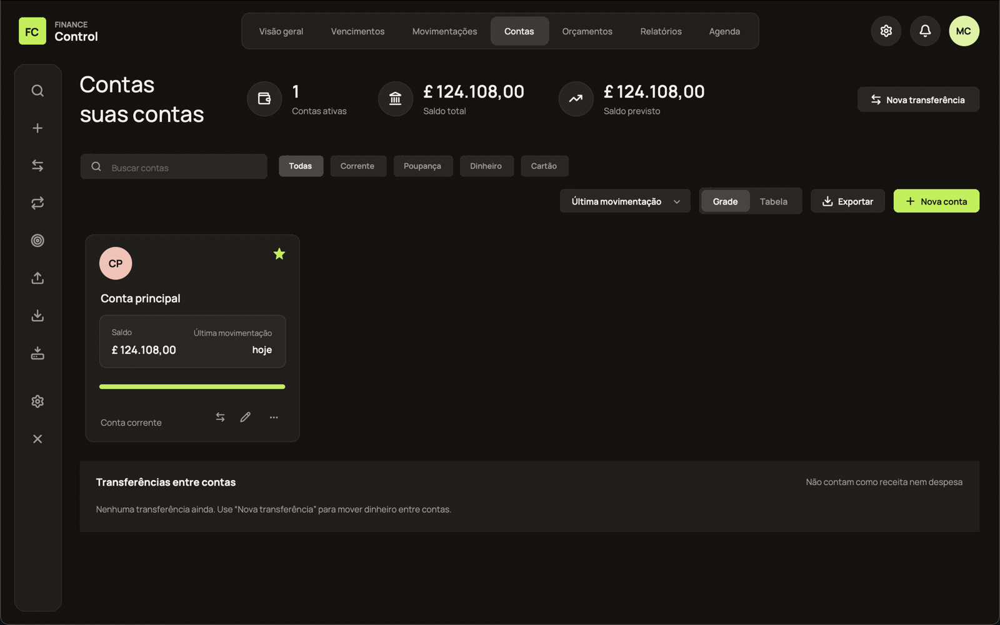
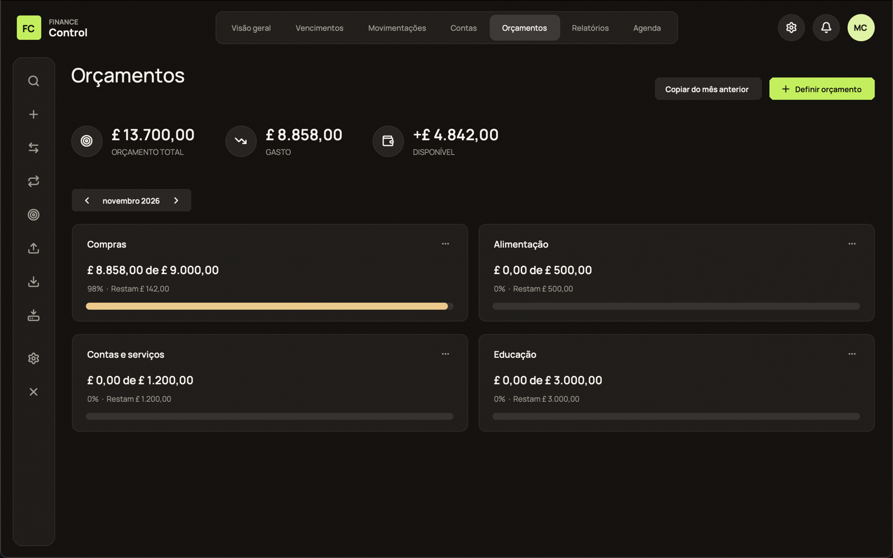
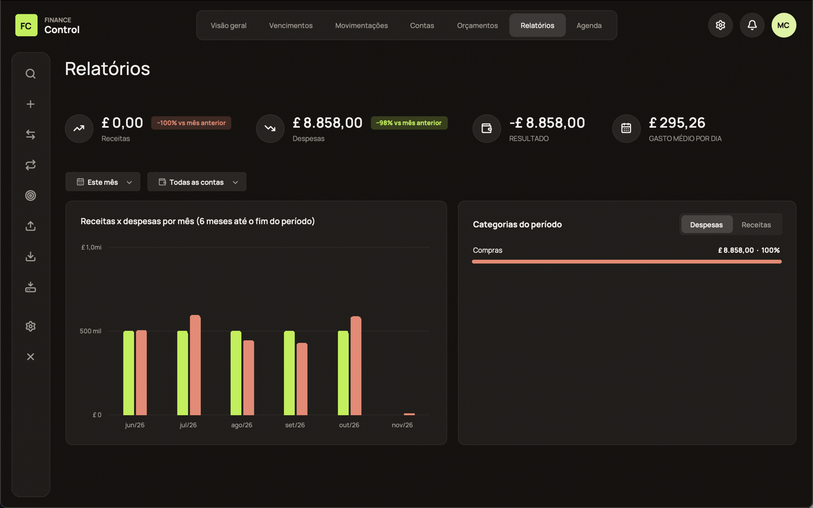
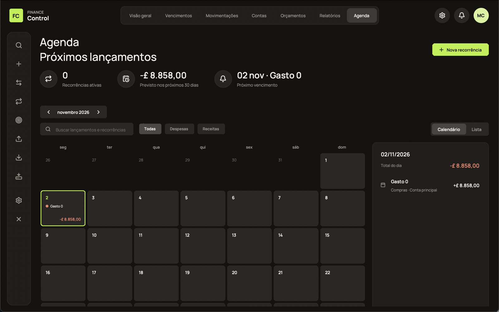
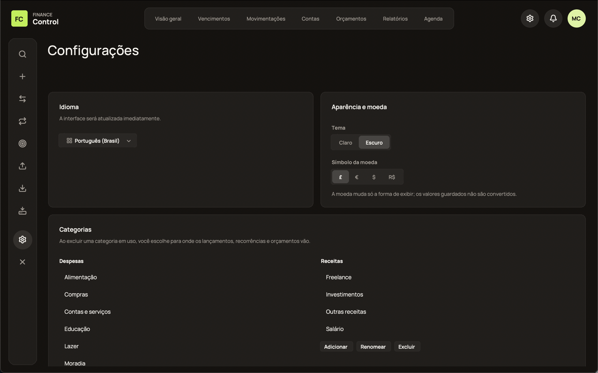

# Finance Control 2.0

Personal finance control for the desktop (Python + Tkinter + SQLite). It works 100% offline:
**no financial data leaves your computer**, and the app does not use the internet.

## What the app does
- **Overview** (dashboard): income for the month (with comparison to the previous month), total balance today, % of the monthly budget used, expense chart (6 or 12 months), biggest expenses of the month, monthly goal, expenses by category, and upcoming bills.
- **Due dates**: the month's bills, with a "Posted" column for expenses already posted.
- **Transactions**: quick entry, search (accent-insensitive), filters (period, type, category, account), sorting, duplicate, edit, delete **with undo**, installments (the amount is split without losing cents), CSV export and import.
- **Accounts and transfers**: several accounts (checking, savings, cash, credit card), each with its own balance. Transfers move money between accounts and **are not counted as income or expense**.
- **Budgets**: monthly budgets by category, with copy from the previous month.
- **Reports**: any period, per account, comparison with the previous period, and category ranking.
- **Schedule**: recurring items (rent, subscriptions, salary… weekly/monthly/yearly), created automatically without duplicates, with pause, edit and delete. It replaces the old Recurring screen.
- **Backup**: automatic (1 per day + 1 before each database update), manual, copy and restore.
- Dark theme as the default in new installations (an existing preference is kept), optional light theme, currencies £ € $ R$, interface in 9 languages (pt-BR, en, es, fr, it, de, ru, zh-CN, ja), and shortcuts (⌘N new transaction, ⌘F search, ⌘1…7 screens, ⌘, settings).

## Screenshots
Captured with sample data (the default interface language is Portuguese).

| Overview | Due dates |
|---|---|
|  |  |
| **Transactions** | **Accounts** |
|  |  |
| **Budgets** | **Reports** |
|  |  |
| **Schedule** | **Settings** |
|  |  |

## Install on a Mac (without VS Code)
1. Install **Python 3.12** from <https://www.python.org/downloads/macos/> (once; the Python that comes with macOS has an old Tk and does not work).
2. **Double-click** `Criar_App_Mac.command` (first time: right-click → Open → Open). It runs the tests, builds `Finance Control.app` and `dist/FinanceControl.dmg`, installs it in Applications, creates a Desktop shortcut and opens the app. It needs internet only to download PyInstaller.
3. Done: open the app from its icon. To run it without installing, use `Abrir_Finance_Control.command`.

As an alternative without using the Mac Terminal, `.github/workflows/build-macos.yml` builds the `.dmg` in GitHub's cloud (Actions → Build macOS app → Run workflow).

> Honest status: the code and tests were verified on Linux. The `.app/.dmg` build **could not be tested** outside a Mac; see `CHANGELOG.md`.

## Where your data is stored
- macOS: `~/Library/Application Support/Finance Control/` (database `finance_control.db`, `backups/`, `logs/`).
- To change the location: set the `FINANCE_CONTROL_DATA` environment variable.
- On first launch, if `data/finance_control.db` exists in the project folder and there is no database in the location above yet, it is **copied** (the original is never changed) and updated with an automatic backup.
- To bring data from another file: Settings → Backup → *Restore from file…* (the app keeps a copy of the current state first).

## Update without losing data
Rebuild the app (`Criar_App_Mac.command`). Data is stored outside the app and is never deleted on update. Database structure changes are versioned migrations, always preceded by a backup.

## Development
```
python3.12 -m backend.main               # run
python3.12 -m unittest discover -s tests -t .   # automated tests
```
UI tests need a display (on a server: `xvfb-run -a ...`); without one they are skipped. The runtime dependency is Pillow (`requirements.txt`); `requirements-build.txt` is used only for packaging.

Structure: `backend/` (app entry point, settings, business rules and utilities) · `frontend/` (screens) · `database/` (SQLite, migrations and backup) · `tests/` · `packaging/` · `locales/` (texts in the 9 languages).

## Important rules
- Amounts are stored as integers (cents). Input accepts `25,50`, `25.50`, `1.234,56` and `1,234.56`; it rejects zero, negatives, letters and more than 2 decimal places.
- Dates are entered as DD/MM/YYYY on screen and stored in ISO format. Future entries do not change today's balance (they appear as "planned").
- Deleting a category in use requires choosing another one to receive its entries; an account with history can only be archived (and only with a zero balance).
